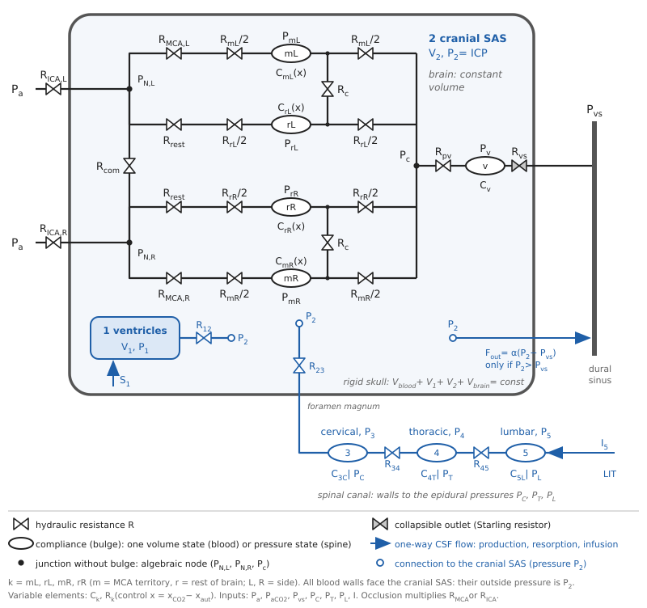
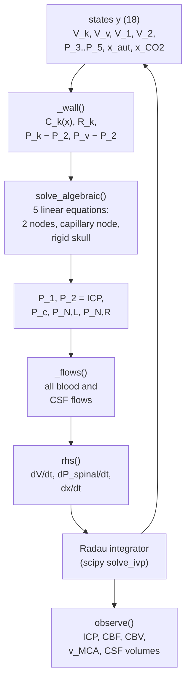
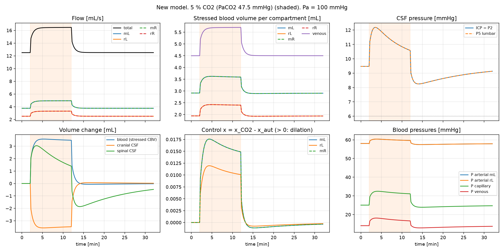
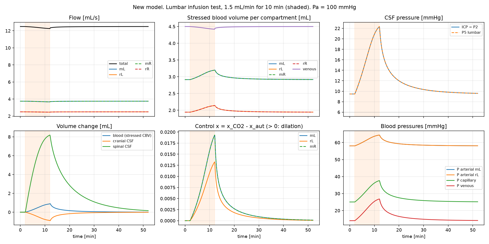
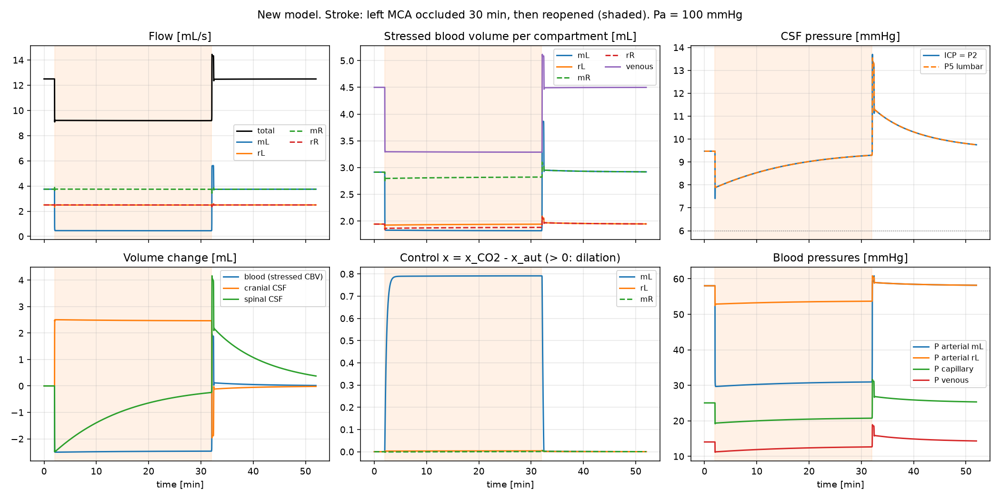
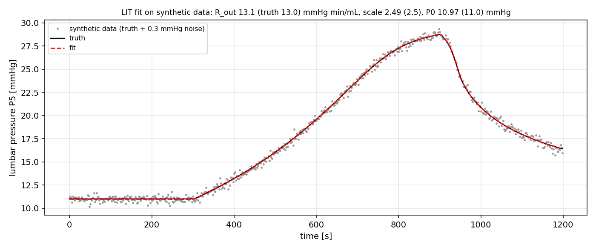

# A new 0D model of cerebral blood volume and CSF dynamics

*Model description and README · Bachelor's thesis: 0D model of cerebral blood flow and CSF dynamics · state of 21 November 2026 (branch `new-model`)*

All numbers below come from the current code: `python run.py new` and its stages (Section 6). The regression test
`tests/test_regression.py` checks that they do not change. *(inference)* marks an interpretation, not a code result.

> **Summary**
>
> 1. **One model, not a coupling.** It takes the vessel walls, autoregulation and CO2 reactivity from Ursino & Giannessi (2010)
>    and the CSF compartments and spinal walls from Vaněk (2015), and puts them inside one rigid skull:
>    4 arterial compartments (MCA territory and rest of brain, left and right), 1 venous compartment, 5 CSF compartments.
> 2. **Volumes are the states, ICP is solved.** 18 differential equations (blood and CSF volumes, spinal CSF pressures,
>    control states). ICP and four other pressures are algebraic: at every instant they take the values at which the volume
>    balance of the full, rigid skull holds.
> 3. **The resting state uses literature values only, nothing is fitted:** ICP 9.47 mmHg, CBF 12.5 mL/s, stressed blood volume 14.2 mL.
> 4. **The three required scenarios.** 5 % CO2: CBF +31.7 %, stressed CBV +3.5 mL. Lumbar infusion test (1.5 mL/min for 10 min):
>    CBV **rises** by 0.9 mL. Left MCA occlusion (30 min): residual flow 12 % of rest in the territory, CBV −2.5 mL.
> 5. **It agrees with the code of the source models** on the scenarios each of them can run: within 0.5 percentage points of
>    Ursino's code in flow (MCA occlusion, 5 % CO2, arterial pressure 100 → 80 mmHg) and within 9 % of Vaněk's code in the ICP
>    rise after 5 min of infusion.
> 6. **Known limits:** no patient data yet; stressed (not absolute) volumes; the ICA occlusion is not validated (no basilar
>    inlet); the cardiac ICP pulse is about 1.8× too large.

---

## 1. Purpose and requirements

The model simulates the **time course of the intracranial volumes** (cerebral blood volume CBV, CSF volume, brain volume)
together with ICP and the regional blood flows, in three scenarios:

| Scenario | Question | Minimal mechanism needed |
| ------ | ------ | ------ |
| Hypercapnic challenge (CO2) | By how many percent does CBV rise? | CO2 → arteriolar dilation (Ursino's control of the compliance) |
| Lumbar infusion test (LIT) | How does cerebral volume change when CSF pressure rises? | Spinal CSF chain and resorption (Vaněk), ICP acting on the vessels |
| Ischemic stroke (MCA occlusion) | Does CBV of the territory collapse or stagnate? | At least two blood compartments per side with a collateral path |

Design choices and why:

| Choice | Why |
| ------ | ------ |
| A new model from the physics of both, not Ursino → CSV → Vaněk | The coupled pipeline passed pressures between two models that each lacked half of the picture (Vaněk has no blood compartments, Ursino has no CSF volumes). One model can conserve volume across blood and CSF. |
| 4 arterial compartments: MCA territory + rest of brain, per side | A stroke needs more than one blood compartment per side, so that blood can reach the occluded territory by another route (anastomosis $R_c$). Finer anatomy would add parameters that cannot be measured. |
| Circle of Willis lumped into 5 resistances | Enough to occlude an MCA or an ICA; all values follow from Ursino's geometry or his resistances (Section 3.7). |
| 1 shared venous compartment with a collapsible outlet | It holds about a third of the stressed CBV (4.5 of 14.2 mL) and takes half of the stroke drop. Ursino also uses one shared venous bed. |
| Vaněk's 5 CSF compartments and spinal walls | Needed for the LIT (infusion into the lumbar compartment). Where Ursino and Vaněk disagree, Vaněk is followed unless that goes against physiology. |
| Blood walls use Ursino's laws, CSF walls Vaněk's | Vaněk has no autoregulation or CO2 mechanism, and his venous-wall parameters are untuned placeholders. |
| Volumes as states, the skull rigid, brain volume constant | The quantity of interest is volume over time, with real initial volumes. A rigid skull filled with incompressible contents turns the cranial pressures into algebraic unknowns (Section 3.1). Edema and brain deformation are left for later. |
| Pulsatile-capable equations, scenarios run with mean inputs | CBV varies within each heartbeat, so a recorded arterial waveform must be accepted as input; the slow scenarios do not need it. |

The source models (`cbfcsf/models/ursino_2010.py`, `vanek_2015.py`, `stepanik_2009.py`) are not modified: the new model is a
separate file, `cbfcsf/models/new_model.py`.

## 2. Variable declaration

**Fig. 1.** Hydraulic analog of the new model as implemented in `cbfcsf/models/new_model.py` (drawn in the style of
Ursino & Giannessi 2010, Fig. 1). Every bulge is one state: a blood volume inside the skull, a CSF pressure in the spinal
canal. Junctions without a bulge are algebraic nodes. The skull is rigid and has no compliance of its own; the cranial
SAS fills the space around the vessels, and its pressure $P_2$ (= ICP) is algebraic too. Black: blood; blue: CSF.

**Table 1.** Symbols, code names, meanings and units. $k \in \lbrace mL, rL, mR, rR \rbrace$ ($m$ = MCA territory, $r$ = rest of brain;
$L$, $R$ = side); $S \in \lbrace L, R \rbrace$.

| Symbol | Code name | Meaning | Unit |
| ------ | ------ | ------ | ------ |
| **Inputs** (functions of time, class `Inputs`) | | | |
| $P_a$ | `Pa` | arterial pressure at both ICA inlets (100 at rest) | mmHg |
| $P_{aCO_2}$ | `PaCO2` | arterial CO2 partial pressure (40 at rest) | mmHg |
| $P_{vs}$ | `Pvs` | dural sinus pressure (6) | mmHg |
| $P_C, P_T, P_L$ | `PC`, `PT`, `PL` | epidural pressures, cervical, thoracic, lumbar (2) | mmHg |
| $I_1 \dots I_5$ | `infusion(t)` | infusion rates into the CSF compartments (LIT: $I_5$) | mL/s |
| – | `occlusion(t)` | multipliers of $R_{MCA,L}, R_{MCA,R}, R_{ICA,L}, R_{ICA,R}$ (1 = open, 1000 = occluded) | – |
| **State variables** `y` (18) | | | |
| $V_k$ | `y[0:4]` | arterial (arteriolar) stressed volumes, order mL, rL, mR, rR | mL |
| $V_v$ | `y[4]` | venous stressed volume | mL |
| $V_1, V_2$ | `y[5]`, `y[6]` | CSF volume of the ventricles and of the cranial SAS | mL |
| $P_3, P_4, P_5$ | `y[7:10]` | CSF pressure, cervical, thoracic, lumbar | mmHg |
| $x_{aut,k}$ | `y[10:14]` | autoregulation state | – |
| $x_{CO_2,k}$ | `y[14:18]` | CO2 reactivity state | – |
| **Algebraic unknowns** (5, solved at every call of `solve_algebraic()`) | | | |
| $P_1$ | `P1` | ventricular CSF pressure | mmHg |
| $P_2$ | `P2`, output `ICP` | cranial SAS pressure = **ICP** | mmHg |
| $P_c$ | `Pc` | capillary pressure (all four compartments drain here) | mmHg |
| $P_{N,L}, P_{N,R}$ | `PNL`, `PNR` | node pressures of the lumped Circle of Willis | mmHg |
| **Derived quantities** (computed from states and unknowns) | | | |
| $P_k$ | `Pk` | pressure in arterial compartment $k$: $P_2 + V_k/C_k$ | mmHg |
| $P_v$ | `Pv` | venous pressure | mmHg |
| $q^{in}_k$, $q_k$ | `q_in`, `q_k` | inflow into and outflow from compartment $k$; $q_k$ is sensed by the controllers | mL/s |
| $q^c_S$ | `q_c` | anastomotic flow rest → MCA territory of side $S$ | mL/s |
| $q_{ICA,S}$, $q_{pv}$, $q_{vs}$ | `q_ICA`, `q_pv`, `q_vs` | ICA inflow; capillary → venous; venous → sinus | mL/s |
| $F_{12} \dots F_{45}$, $F_{out}$ | `F12`, `F23`, `F_out` | CSF flows along the chain; resorption into the sinus | mL/s |
| CBF | `CBF` | total flow $\sum_k q_k$ | mL/s |
| $V_{blood}$ | `Vblood` | stressed CBV $= \sum_k V_k + V_v$ | mL |
| CBV % | `CBV_pct` | change of $V_{blood}$ in % of a total CBV at rest (placeholder 56 mL) | % |
| $v_{MCA}$ | `v_MCA` | flow velocity in the MCA (as a transcranial Doppler would see it) | cm/s |
| **Variable elements** | | | |
| $C_k(x_k)$ | `C` | arteriolar compliance, sigmoid of $x_k = x_{CO_2,k} - x_{aut,k}$ | mL/mmHg |
| $R_k$ | `R` | arteriolar resistance $R_{n,k}(V_{n,k}/V_k)^2$ | mmHg·s/mL |
| $P_v - P_2$ | `wv` | venous transmural pressure, grows exponentially with $V_v$ | mmHg |
| $C_{3C}, C_{4T}, C_{5L}$ | `wall_compliance(...)` | spinal wall compliances, fall with the transmural pressure | mL/mmHg |
| $R_{vs}$ | – | collapsible outlet (Starling resistor): drains to $\max(P_2, P_{vs})$ | mmHg·s/mL |

## 3. Methods

### 3.1 Why the states are volumes and ICP is solved

Think of the skull as a **rigid box that is completely full** of brain (constant volume), blood and CSF, all incompressible.
If 1 mL more blood is in the box, 1 mL of CSF must leave it at the same moment. The only ways out are:

- CSF moves down into the **spinal canal**, whose walls give way;
- CSF is **resorbed** into the dural sinus;
- **venous blood** leaves the skull.

So the volumes are the natural states: each has a conservation law $\dot V = \text{inflow} - \text{outflow}$. ICP is different:
the box cannot store anything, so at every instant

$$\underbrace{q_{ICA,L} + q_{ICA,R}}_{\text{blood in}} - \underbrace{q_{vs}}_{\text{blood out}} + S_1 + I_1 + I_2 - F_{23} - F_{out} = 0 \qquad \text{(S)}$$

(Monro–Kellie in rate form). ICP is the pressure at which this holds. It is not integrated in time but **solved** at every
step, together with four other pressures (Section 3.5).

This is the main difference from the two source models *(inference from their equations)*:
- Ursino lumps all craniospinal storage into one intracranial compliance $C_{ic}$, which makes ICP a state. Here the same
  storage sits in the spinal walls, scaled to his value at rest (Section 3.6).
- Vaněk has no blood compartments, only walls to blood at a prescribed pressure.

### 3.2 Pressures from volumes (wall laws)

All blood walls face the cranial SAS ($\varphi_a = \varphi_v = 1$ in the code, Section 3.7), so the outside pressure of every
blood compartment is $P_2$.

Arterial compartments (Ursino Eq. 13 integrated, Eq. 24–26), `NewModel._wall()`:

$$P_k = P_2 + \frac{V_k}{C_k(x_k)}, \qquad x_k = x_{CO_2,k} - x_{aut,k} \qquad (1)$$

$$C_k(x) = C_{n,k} \frac{(1-\text{sat}) + (1+\text{sat}) e^{x/k_C}}{1+e^{x/k_C}}, \qquad k_C = \tfrac12 C_{n,k} \cdot \text{sat} \qquad (2)$$

with $\text{sat} = \text{sat}_1 = 7$ for $x < 0$ (constriction) and $\text{sat} = \text{sat}_2 = 0.4$ for $x > 0$ (dilation), and the bound $C_k \ge 0.05 C_{n,k}$ (Ursino's $\text{sat}_1 = 7$ would allow a negative compliance; the bound was never
active in any scenario). One number, the compliance, sets both how much blood the compartment holds and how easily blood flows
through it:

$$R_k = R_{n,k}\left(\frac{V_{n,k}}{V_k}\right)^{2} \qquad (3)$$

(Ursino's $R = k_R C_n^2/V^2$ written around the resting state). A fuller vessel is a wider vessel and has much less resistance.

Venous compartment (Ursino Eq. 11–12 integrated: $C_v = 1/(k_{ven} u)$ gives an exponential law):

$$P_v = P_2 + P_{v1} + u_n e^{ k_{ven}(V_v - V_{vn})}, \qquad u_n = P_{v,n} - P_{2,n} - P_{v1} = 7.07\ \text{mmHg} \qquad (4)$$

The vein stiffens as it fills.

Spinal walls (Vaněk Eq. 5.2.2, with the exponents of Štěpáník's MATLAB code), e.g. cervical:

$$C_{3C} = C^0_{3C} e^{-r \lvert P_3 - P_C\rvert^{a}}, \qquad a = r = 0.6 \qquad (5)$$

### 3.3 Flows

Half of $R_k$ lies on each side of the compartment, as in Ursino's districts (`NewModel._flows()`):

$$q^{in}_{mS} = \frac{P_{N,S} - P_{mS}}{R_{MCA,S} + R_{mS}/2}, \qquad q^{in}_{rS} = \frac{P_{N,S} - P_{rS}}{R_{rest} + R_{rS}/2}, \qquad q_k = \frac{P_k - P_c}{R_k/2} \qquad (6)$$

$$q^{c}_{S} = \frac{P_{rS} - P_{mS}}{R_c}, \qquad q_{ICA,S} = \frac{P_a - P_{N,S}}{R_{ICA,S}} \qquad (7)$$

Venous inflow, and outflow through the collapsible terminal veins (Ursino Eq. 10; it collapses when ICP exceeds the sinus
pressure, and then the outflow depends on $P_v - P_2$, not on $P_{vs}$):

$$q_{pv} = \frac{P_c - P_v}{R_{pv}}, \qquad q_{vs} = \frac{P_v - \max(P_2, P_{vs})}{R_{vs1}} \qquad (8)$$

CSF (Vaněk Eq. 5.2.6; resorption is linear above the sinus pressure):

$$F_{12} = \frac{P_1-P_2}{R_{12}},\quad F_{23} = \frac{P_2-P_3}{R_{23}},\quad F_{34} = \frac{P_3-P_4}{R_{34}},\quad F_{45} = \frac{P_4-P_5}{R_{45}},\quad F_{out} = \alpha \max(P_2 - P_{vs}, 0) \qquad (9)$$

### 3.4 Differential equations (`NewModel.rhs()`)

Blood volumes (mass conservation):

$$\dot V_{mS} = q^{in}_{mS} - q_{mS} + q^{c}_{S},\qquad \dot V_{rS} = q^{in}_{rS} - q_{rS} - q^{c}_{S},\qquad \dot V_v = q_{pv} - q_{vs} \qquad (10)$$

Cranial CSF volumes (Vaněk Eq. 5.2.5; constant production $S_1$ into the ventricles):

$$\dot V_1 = S_1 - F_{12} + I_1,\qquad \dot V_2 = F_{12} - F_{23} - F_{out} + I_2 \qquad (11)$$

Spinal CSF (Vaněk Eq. 5.2.7; the epidural pressures are inputs):

$$C_{3C}(\dot P_3 - \dot P_C) = F_{23} - F_{34} + I_3,\qquad C_{4T}(\dot P_4 - \dot P_T) = F_{34} - F_{45} + I_4,\qquad C_{5L}(\dot P_5 - \dot P_L) = F_{45} + I_5 \qquad (12)$$

Control (Ursino Eq. 21–23), for each compartment $k$:

$$\tau_{aut} \dot x_{aut,k} = -x_{aut,k} + G_{aut} \frac{q_k - q_{n,k}}{q_{n,k}} \qquad (13)$$

$$\tau_{CO_2} \dot x_{CO_2,k} = -x_{CO_2,k} + G_{CO_2} A_k \log_{10}\frac{P_{aCO_2}}{P_{aCO_2,n}},\qquad A_k = \frac{1}{1+\exp\big[-k_{CO_2}\big(\tfrac{q_k-q_{n,k}}{q_{n,k}} - b_{CO_2}\big)\big]} \qquad (14)$$

Autoregulation constricts when the flow is above normal; CO2 dilates; $A_k$ switches the CO2 response off when the flow falls
below about half of normal (ischemia). In hypercapnia the two pull against each other.

### 3.5 Algebraic equations and how one time step is computed

Five unknowns, $z = (P_1, P_2, P_c, P_{N,L}, P_{N,R})$, and five equations (`NewModel.solve_algebraic()`):

$$\frac{P_a - P_{N,S}}{R_{ICA,S}} + \frac{P_{N,Z} - P_{N,S}}{R_{com}} = q^{in}_{mS} + q^{in}_{rS} \quad (S = L, R;\ Z = \text{other side}) \qquad (15)$$

$$\sum_k q_k = q_{pv} \qquad \text{(capillary node)} \qquad (16)$$

$$\dot V_1 = 0, \qquad \dot V_2 = -\Big(\sum_k \dot V_k + \dot V_v\Big) \qquad \text{(rigid skull, wall by wall)} \qquad (17)$$

Equation (17) says that the blood volume entering the skull pushes the same volume of CSF out of the SAS. Its sum with (10)
and (11) gives (S). Because the blood walls face the SAS only, the ventricular volume stays constant and
$P_1 = P_2 + R_{12}(S_1 + I_1)$.

For given states, all five equations are **linear** in $z$, apart from two switches: whether the outlet veins are collapsed
($P_2 \ge P_{vs}$) and whether resorption is active ($P_2 > P_{vs}$). So every evaluation of the right-hand side solves one
5 × 5 linear system, and repeats it if a switch changed (at most 4 times). In all scenario runs the switches were self-consistent.

**Fig. 2.** What happens at every evaluation of the right-hand side:

### 3.6 Resting state (`NewModel._calibrate()`)

Computed from the literature values of Section 3.7 with four conditions: $P_a$ = 100 mmHg, every compartment carries its
basal flow, no flow through the anastomoses ($P_m = P_r$), CSF production = resorption. Nothing is fitted.

| Quantity | Value | How it follows |
| ------ | ------ | ------ |
| ICP $P_2$ | 9.47 mmHg | $P_{vs} + S_1/\alpha$ (production = resorption; Ursino's basal value 9.5) |
| Ventricular pressure $P_1$ | 10.49 mmHg | $P_2 + R_{12} S_1$ |
| Venous pressure $P_v$ | 14.05 mmHg | $P_2 + q_n R_{vs1}$ (Ursino 14) |
| Capillary pressure $P_c$ | 25.05 mmHg | $P_v + q_n R_{pv}$ (Ursino 25) |
| Node pressure $P_N$ | 96.44 mmHg | $P_a - R_{ICA}(q_{n,m} + q_{n,r})$ |
| Arterial compartment pressure $P_k$ | 58.04 mmHg | from the resistances at basal flow (Ursino 58.5) |
| Basal flows $q_{n,m}$, $q_{n,r}$ | 3.75, 2.50 mL/s | territory weights 0.30, 0.20 × 12.5 mL/s |
| $R_{n,m}$, $R_{n,r}$ | 17.60, 26.40 mmHg·s/mL | pressure drop $P_N \to P_c$ at basal flow; $P_r = P_m$ |
| $R_{rest}$ | 2.16 mmHg·s/mL | closes the "rest" branch (Ursino's ACA and PCA paths in parallel: 2.42) |
| Arterial stressed volumes $V_{n,m}$, $V_{n,r}$ | 2.91, 1.94 mL (total 9.71) | $C_n \times (P_k - P_2)$ (Ursino $V_{dn}$: 10.1 mL) |
| Venous stressed volume $V_{vn}$ | 4.5 mL | Ursino "4–5 mL"; an offset only |
| Spinal compliance scale $s$ | 2.09 | storage at rest = Ursino's $1/(k_E P_2)$ = 1.37 mL/mmHg (Vaněk's raw values: 0.66) |
| MCA velocity | 60.9 cm/s | $q_{n,m}/(\pi r_{MCA,n}^2)$ |

**Key fact:** in any steady state ICP $= P_{vs} + (S_1 + I)/\alpha$, **whatever the blood volume is**. Blood volume changes
move ICP only temporarily, until resorption has removed or replaced the displaced CSF.

Why the spinal storage is scaled: Vaněk's own model stores volume also in its venous walls ($C_{1b}$, $C_{2b}$), which do not
exist here. Scaling his three spinal compliances by one factor gives the storage of Ursino's model at rest. It changes ICP, not
CBV (CBV results differ by less than 0.06 mL between the two). `NewModel.vanek_values()` gives the raw values.

### 3.7 Parameters

Units: pressure mmHg, volume mL, flow mL/s, resistance mmHg·s/mL, compliance mL/mmHg. Any parameter can be overridden by
keyword, e.g. `NewModel(kappa_v=0.1)`; the resting state is then recomputed.

| Parameter | Code name | Value | Category | Source |
| ------ | ------ | ------ | ------ | ------ |
| $\tau_{aut}$, $G_{aut}$ | `tau_aut`, `G_aut` | 20 s, 0.9 | known | Ursino Table 1 |
| $\tau_{CO_2}$, $G_{CO_2}$ | `tau_CO2`, `G_CO2` | 40 s, 4.0 | known | Ursino Table 1 |
| $\text{sat}_1$, $\text{sat}_2$ | `sat1`, `sat2` | 7, 0.4 | known (sat1 doubtful) | Ursino Table 1 |
| $k_{CO_2}$, $b_{CO_2}$, $P_{aCO_2,n}$ | `k_CO2`, `b_CO2`, `PaCO2_n` | 15, −0.5, 40 mmHg | known | Ursino Table 1 and text (see note) |
| $R_{pv}$, $R_{vs1}$ | `R_pv`, `R_vs1` | 0.880, 0.366 | known | Ursino Table 1 |
| $k_{ven}$, $P_{v1}$ | `k_ven`, `P_v1` | 0.155 mL⁻¹, −2.5 mmHg | known | Ursino Table 1 |
| $P_{vs}$ | `Pvs_n` | 6 mmHg | known | Ursino Table 1 |
| $q_n$, $C_n$ (totals) | `q_n_total`, `C_n_total` | 12.5 mL/s, 0.200 | known | Ursino Table 1 |
| Territory weights (MCA, rest) | `w` | 0.30, 0.20 per side | known | Ursino Table 1 ($W_{MCA}$; $W_{ACA2}+W_{PCA2}$) |
| $R_{ICA}$, $R_{MCA}$ | `R_ICA`, `R_MCA` | 0.569, 1.44 | known | Hagen–Poiseuille with Ursino's geometry |
| $R_c$ (MCA ↔ rest) | `R_c` | 56 | known | Ursino's $R_{c,am}$ = 105 and $R_{c,pm}$ = 120 in parallel |
| $k_E$ | `k_E` | 0.077 mL⁻¹ | known | Ursino Table 1 (storage target only) |
| $r_{MCA,n}$, $k_{MCA}$ | `r_MCA_n`, `k_MCA` | 0.14 cm, 12 | known | Ursino Table 1, Eq. 19–20 (output $v_{MCA}$ only) |
| $R_{12}$, $R_{23}$, $R_{34}$, $R_{45}$ | `R12` … `R45` | 160, 0.30, 0.40, 0.30 | known | Vaněk Tab. 6.2.1 |
| $C^0_{3C}$, $C^0_{4T}$, $C^0_{5L}$ | `C3C0`, `C4T0`, `C5L0` | 1.125, 1.5, 2.25 (× $s$) | known | Vaněk Tab. 6.2.1 |
| $a$, $r$ (spinal walls) | `a_sp`, `r_sp` | 0.6, 0.6 | unknown | Štěpáník's MATLAB code only |
| $S_1$ | `S1` | 550 mL/day | known | Vaněk |
| $\alpha$ | `alpha` | 0.11 mL·min⁻¹·mmHg⁻¹ | known, estimable | Štěpáník's MATLAB code; $1/\alpha$ is the outflow resistance of a LIT |
| $V_{10}$, $V_{20}$ | `V10`, `V20` | 30, 90 mL | known | Štěpáník's MATLAB code |
| $P_C$, $P_T$, $P_L$ (mean) | `P_epi_n` | 2 mmHg | known | Vaněk |
| $\varphi_a$, $\varphi_v$ | `phi_a`, `phi_v` | 1, 1 | decided | share of a blood wall facing the SAS (the rest faces the ventricles); $\varphi_v$ = 0.5 makes the ventricular pressure unstable |
| $R_{com}$ | `R_com` | 15 | unknown | start value: Ursino's ACoA (14.9); matters only for an ICA occlusion |
| $V_{vn}$ | `V_vn` | 4.5 mL | unknown | Ursino "4–5 mL"; shifts $V_v$ by a constant |
| $C_{min}$ | `C_min_frac` | 0.05 $C_n$ | unknown | bound against a negative compliance |
| Total CBV at rest | `CBV_total_n` | 56 mL | placeholder | 4 mL/100 g × 1400 g, not from the project sources; sets the % output only |
| $\kappa_v$, $s_C$ | `kappa_v`, `kC_scale` | 0, 1 | options | off by default (Section 4.9) |

Note on $b_{CO_2}$: the printed Eq. 23 of Ursino & Giannessi reads differently from their text and from their own code. The
form used here follows the text ($A \approx 1$ at rest). The literal reading changes no scenario result.

### 3.8 Scenarios, solver and checks

| Scenario | Protocol (all start from the resting state) |
| ------ | ------ |
| Rest | constant inputs, 600 s |
| CO2 challenge | $P_{aCO_2}$ 40 → 60 mmHg (10 s ramp) at 120 s, held 600 s, back to 40; run to 3600 s |
| 5 % CO2 | as above with 47.5 mmHg (an assumed value for 5 % CO2 inhalation, not from the model sources); run to 1920 s |
| LIT | 1.5 mL/min into compartment 5 from 120 s for 10 min; run to 3120 s. Plateau check: constant infusion for 5000 s |
| MCA occlusion (stroke) | $R_{MCA,L}$ × 1000 (5 s ramp) at 120 s for 30 min, then reopened; run to 3120 s |
| ICA occlusion | $R_{ICA,L}$ × 1000, same timing |
| Pulsatile | $P_a = 100 + 10\sin(2\pi\cdot 1.2 t)$ for 30 s |

Solver: `scipy.integrate.solve_ivp`, Radau, rtol $10^{-7}$, atol $10^{-9}$, maximum step 5 s (pulsatile run: rtol $10^{-6}$,
atol $10^{-8}$, maximum step 0.02 s).

The bounds of the scenario checks were written down before each scenario was coded; those of the later cross-checks X3,
X4 and X2c after exploratory runs, so they are regression bounds around a known agreement. Every run is checked for:
- the rigid skull ($\lvert\Delta(\sum V_k + V_v + V_1 + V_2)\rvert$ below $10^{-3}$ mL);
- the algebraic residual (below $10^{-8}$ mL/s);
- the CSF bookkeeping (volume change = production + infusion − resorption, within 0.05 mL);
- left–right symmetry where the inputs are symmetric.

The default run has **77 pass/fail checks, all pass, plus 5 informational rows** (Appendix A).

## 4. Results

### 4.1 Overview

Stressed CBV = $\sum_k V_k + V_v$; changes are from rest to the end of the intervention (`python run.py new`).

| Scenario | CBF | Stressed CBV | of which arterial / venous | ICP [mmHg] (rest 9.47) |
| ------ | ------ | ------ | ------ | ------ |
| 5 % CO2 (47.5 mmHg, 10 min) | +31.7 % | **+3.48 mL** | +2.27 / +1.20 | peak 12.19, end 10.58 |
| CO2 60 mmHg (10 min) | +54.8 % | +6.06 mL | +4.10 / +1.96 | peak 14.60, end 11.53 |
| LIT 1.5 mL/min (10 min) | −1.9 % | **+0.88 mL** | +0.96 / −0.08 | 22.32 at the end of infusion (plateau 23.11) |
| Left MCA occlusion (30 min) | −26.5 % | **−2.46 mL** | −1.25 / −1.21 | dips to 7.41, 9.29 after 30 min, 13.70 on reopening |
| Left ICA occlusion (30 min), not validated | −30.3 % | −2.30 mL | −0.89 / −1.41 | dips to 7.40, 9.30 after 30 min |

All scenarios are reversible: after the intervention, flows, volumes and ICP return to rest within the checked bounds.

### 4.2 CO2 challenge

**Fig. 3.** 5 % CO2 ($P_{aCO_2}$ 47.5 mmHg for 10 min, shaded). Same panel layout in Figs. 3–5.

What happens, step by step:
1. CO2 rises → $x_{CO_2}$ rises → the arterioles get more compliant (dilate).
2. More compliant means more volume **and** less resistance (Eq. 3) → flow rises (+31.7 %); autoregulation partly pulls back.
3. Higher flow → higher venous pressure → the veins fill (+1.2 mL).
4. More blood in the skull (+3.5 mL) → the same volume of CSF is pushed into the spinal canal → ICP peaks (12.2 mmHg).
5. Over minutes resorption removes the extra CSF → ICP drifts back toward 9.47 mmHg even while CO2 stays high.
6. CO2 off → the vessels shrink → the resorbed CSF is now missing → ICP dips below rest (8.25), then refills at the production rate.

Above about 55 mmHg the arterioles are fully dilated ($\text{sat}_2$ = 0.4) and the response saturates: at 60 mmHg CBF rises by
+54.8 %, set by the dilation limit rather than by CO2.

### 4.3 Lumbar infusion test

**Fig. 4.** Lumbar infusion test, 1.5 mL/min into compartment 5 for 10 min (shaded).

1. The infused CSF fills the spinal canal (+8.2 mL at the end of the infusion) and raises ICP toward the plateau where
   resorption equals production + infusion: $P_{vs} + (S_1 + I)/\alpha$ = 23.11 mmHg (reached within 0.1 mmHg in the 5000 s run).
2. Higher ICP lowers the perfusion pressure → flow would fall → autoregulation dilates the arterioles → flow is almost kept (−1.9 %).
3. Dilated arterioles hold **more** blood (+0.96 mL).
4. The veins hardly change (−0.08 mL): with the collapsed outlet, the venous transmural pressure is $P_v - P_2 = q_{vs} R_{vs1}$
   (Eq. 8), which depends on the flow, not on ICP.
5. Result: CBV **rises** slightly (+0.88 mL).

A fall of CBV during an infusion test is often expected, because a higher ICP should squeeze the veins. In this model that
needs an extra assumption that no source gives: the venous squeeze option $\kappa_v$ (Section 4.9) turns the result negative.

### 4.4 MCA occlusion (stroke)

**Fig. 5.** Left MCA occluded for 30 min (shaded), then reopened.

1. The territory loses its feeding artery → its pressure falls from 58 to about 30 mmHg → it empties passively (−37.6 % volume)
   although its arterioles are fully dilated ($x$ rises to 0.79).
2. It keeps 12.1 % of its flow, which arrives through the anastomosis $R_c$ from the "rest" compartment of the same side.
3. Total flow −26.5 % → the veins fill less (−1.21 mL).
4. Less blood in the skull (−2.46 mL) → CSF is drawn in from the spinal canal → ICP dips (7.4 mmHg), then recovers as CSF is produced.
5. On reopening the territory is still fully dilated → flow overshoots → a short ICP spike (13.7 mmHg).

The right side is unaffected (flows within 0.1 %); brain tissue is not damaged in this model, so everything returns to rest.

### 4.5 ICA occlusion (not validated)

The lumped circle has two inlets, each carrying 50 % of the flow. The real circle has three: each ICA carries 38 % (MCA 30 % +
ACA 8 %) and the basilar artery 24 % (the posterior cerebral arteries). So $R_{ICA}$ here stands for "ICA plus half of the
basilar". Closing it also cuts the posterior supply of that side. This does not affect an MCA occlusion, because that
blockage is downstream of the node.

| Left ICA occluded 30 min | New model | Ursino code |
| ------ | ------ | ------ |
| MCA$_L$ flow | −60.4 % | −55.6 % |
| rest$_L$ flow | −60.4 % | −10.7 % (his ACA$_L$ −26.5 %, PCA$_L$ −0.2 %) |
| Total CBF | −30.3 % | −18.9 % |
| Arterial stressed volume | −0.89 mL | −0.32 mL |

No value of $R_{com}$ repairs the distribution. A third (basilar) inlet would; it is proposed, not implemented.

### 4.6 Comparison with the code of the source models

Each source model can run some of the scenarios. The new model was run against their code (`cbfcsf/crosscheck.py`):

| Scenario | Quantity | New model | Source model code | Check |
| ------ | ------ | ------ | ------ | ------ |
| CO2 60 mmHg | MCA flow rise | +54.8 % | Ursino: +52.3 % | ratio 0.5…1.5, pass |
| 5 % CO2 | total CBF | +31.7 % | Ursino: +31.9 % | ±3 points, pass |
| | arterial stressed volume | +2.27 mL | Ursino: +2.34 mL | ratio 0.85…1.15, pass |
| $P_a$ 100 → 80 mmHg (autoregulation) | total CBF | −11.2 % | Ursino: −10.7 % | ±3 points, pass |
| | arterial stressed volume | +0.96 mL | Ursino: +0.97 mL | ratio 0.85…1.15, pass |
| Left MCA occlusion | residual flow in the territory | 12.1 % | Ursino: 12.3 % | ratio 0.5…2, pass |
| | stressed volume of the territory | −37.6 % | Ursino: −37.5 % | ±15 points, pass |
| | total CBF | −26.5 % | Ursino: −26.3 % | ±10 points, pass |
| LIT ($P_b$ = 10 mmHg in Vaněk's code) | plateau ICP | 23.11 mmHg | Vaněk: 23.64 mmHg | difference 0.53 ± 0.1, pass |
| | ICP rise after 5 min | 7.15 mmHg | Vaněk: 7.86 mmHg | ratio 0.75…1.25, pass |
| | ICP rise after 10 min | 12.85 mmHg | Vaněk: 13.10 mmHg | ratio 0.5…1.5, pass |

How to read it:
- **Ursino.** Merging six districts into four and the Circle of Willis into five resistances lost nothing for CO2,
  autoregulation and MCA occlusion.
- **Vaněk.** The agreement is weaker than it looks. The plateaus differ by exactly the two resorption thresholds (6.53 vs 6 mmHg).
  At 10 min both curves are already close to the same analytic plateau, so that comparison can hardly fail. At 5 min they
  differ by 9 %, and this depends on the venous pressure $P_b$ chosen for Vaněk's code: with $P_b$ = 12 mmHg his code gives
  6.14 mmHg. *(inference)* Vaněk's storage depends on $P_b$ through his venous walls, which this model does not have.

### 4.7 Pulsatile input

| Arterial input | ICP pulse (peak-to-peak) | Stressed CBV pulse |
| ------ | ------ | ------ |
| $P_a = 100 + 10\sin(2\pi\cdot 1.2 t)$ | 3.15 mmHg | 0.82 mL |
| Arterial waveform of Štěpáník's input data file (mean 90 mmHg, pulse 48 mmHg) | 6.37 mmHg (the file's ICP: 3.62) | 1.62 mL |

The equations accept a pulsatile input as they are. With a realistic arterial pulse, though, the ICP pulse is about 1.8× too
large. *(inference)* Almost the whole arterial pulse volume is pushed into the spinal canal: the venous outflow barely
pulsates, because with the collapsible-vein law it depends only on the venous transmural pressure, so the veins cannot carry
the pulse out of the skull. No single parameter fixes it. This concerns the within-beat behaviour only; the slow scenarios are
not affected. The data-file comparison is part of `python run.py new --calibrate` and needs the data file, which is not in
the public repository.

### 4.8 What the answers depend on

Normalised sensitivity $S = (\Delta\text{out}/\text{out}) / (\Delta p/p)$ of the stressed-CBV answer, each parameter changed
by ±20 % with the model recalibrated to its own rest (`python run.py new --params`). $\lvert S\rvert \approx 1$: proportional;
$S \approx 0$: no effect.

| Parameter | $S$ CO2 (5 %) | $S$ LIT | $S$ stroke |
| ------ | ------ | ------ | ------ |
| $G_{CO_2}$ | **0.98** | 0.00 | 0.00 |
| $G_{aut}$ | **−0.97** | 0.27 | 0.00 |
| $C_n$ (arteriolar compliance) | 0.63 | **0.91** | **0.52** |
| $k_{ven}$ (venous stiffness) | −0.37 | 0.10 | **−0.51** |
| $\alpha$ (resorption conductance) | −0.02 | **−0.97** | 0.00 |
| $k_E$ (storage target) | 0.00 | 0.47 | 0.00 |
| $R_{pv}$ | 0.23 | 0.35 | 0.06 |
| $R_{vs1}$ | 0.21 | 0.11 | 0.22 |
| $R_c$ | 0.00 | 0.00 | 0.21 |
| $\text{sat}_2$ | 0.01 | 0.18 | −0.14 |
| $S_1$ | −0.01 | 0.12 | −0.01 |
| $\text{sat}_1$, $R_{com}$, $V_{vn}$ | 0.00 | 0.00 | 0.00 |

- The CO2 answer is set by the ratio of the two gains $G_{CO_2}$ and $G_{aut}$ (opposite signs).
- The LIT answer is set by $\alpha$ and $C_n$.
- The stroke answer is set by $C_n$ and $k_{ven}$.
- The parameters without a defensible value ($\text{sat}_1$, $R_{com}$, $V_{vn}$) have no effect on the three required
  scenarios.
- $R_{com}$ matters only for an ICA occlusion, where it decides the result.

### 4.9 Options, outputs and the LIT fitting tool

**Outputs.**
- `CBV_pct`: the change of CBV in % of a total CBV at rest. The 56 mL baseline is a placeholder; 5 % CO2 gives +6.2 %. A
  real baseline needs perfusion imaging (mL per 100 g).
- `v_MCA`: MCA flow velocity (Ursino Eq. 19–20 with the transmural pressure). It is 60.9 cm/s at rest and rises by +32.1 % in
  5 % CO2.

**Venous squeeze $\kappa_v$ (option, default 0).** The veins feel an extra pressure proportional to the ICP rise:
$P_v = \dots + \kappa_v (P_2 - P_{2,n})$. No source gives $\kappa_v$. It decides the sign of the LIT answer and nothing else:
5 % CO2 +3.39 vs +3.48 mL, stroke −2.44 vs −2.46 mL (`python run.py new --options`).

| $\kappa_v$ | LIT stressed CBV change | arterial | venous | CBF | ICP at end of infusion |
| ------ | ------ | ------ | ------ | ------ | ------ |
| 0 (default, Ursino's law) | **+0.88 mL** | +0.96 | −0.08 | −1.9 % | 22.32 mmHg |
| 0.05 | +0.25 mL | +0.91 | −0.67 | −1.8 % | 21.73 mmHg |
| 0.1 | **−0.38 mL** | +0.86 | −1.24 | −1.6 % | 21.07 mmHg |
| 0.2 | −1.54 mL | +0.76 | −2.30 | −1.4 % | 19.78 mmHg |

**Sigmoid width $s_C$ (option, default 1).** It widens Ursino's $C(x)$ curve so that the CO2 response starts more slowly. The
price is weaker autoregulation: the abrupt onset and the strong autoregulation come from the same steep curve.

| $s_C$ | share of the 10-min CBF rise after 10 s | CBF rise at 60 mmHg | CBF fall at $P_a$ = 80 |
| ------ | ------ | ------ | ------ |
| 1 (Ursino, default) | 72 % | +54.9 % | −11.2 % |
| 3 | 62 % | +54.7 % | −12.8 % |
| 10 | 45 % | +48.2 % | −20.8 % |
| 30 | 31 % | +33.0 % | −31.1 % |

**LIT fitting tool** (`cbfcsf/fit_lit.py`). It takes a measured lumbar pressure curve, the infusion rate and the times when
the infusion starts and stops, and fits three numbers with their standard errors:
- the outflow resistance $R_{out} = 1/\alpha$;
- the spinal storage scale $s$;
- the resting ICP $P_0$.

**Fig. 6.** Fit of a synthetic LIT (truth: $R_{out}$ = 13 mmHg·min/mL, $s$ = 2.5, $P_0$ = 11 mmHg; noise 0.3 mmHg).

| Synthetic data | $R_{out}$ | $s$ | $P_0$ [mmHg] |
| ------ | ------ | ------ | ------ |
| noiseless | 13.00 | 2.50 | 11.00 |
| noise 0.3 mmHg, seed 1 | 13.06 (SE 0.2 %) | 2.49 (SE 0.3 %) | 10.97 (SE 0.02) |
| 8 noise seeds, mean error (sd) | +0.1 % (0.3 %) | −0.2 % (0.4 %) | −0.01 (0.02) |
| data from the model with $\kappa_v$ = 0.1 | 12.85 (−1.2 %) | 3.07 (**+23 %**) | 11.23 |
| data from the model with $\kappa_v$ = 0.2 | 12.82 (−1.4 %) | 3.59 (**+44 %**) | 11.32 |

The last two rows (`--fit-mismatch`) show the limit. When the "patient" differs from the model, the outflow resistance stays
right, but the storage absorbs the difference, and the standard errors (below 1 %) do not show it. They measure noise, not
model error. Only real recordings can show the real uncertainty.

## 5. Limitations and open questions

1. **No patient data.** All parameters are from Ursino, Vaněk and Štěpáník. The results show direction and size, not
   predictions. Next steps: real LIT recordings (for $\alpha$ and the storage, with the fitting tool), and an arterial pressure
   recording with ICP (for the pulse).
2. **Stressed volume only.** The model gives volume changes in mL. A percentage of total CBV needs a baseline from perfusion
   imaging; the 56 mL in `CBV_pct` is a placeholder.
3. **The sign of the LIT answer depends on the venous law.** With Ursino's collapsible veins, CBV rises. A venous squeeze
   ($\kappa_v$) reverses it, but no source constrains $\kappa_v$.
4. **ICA occlusion not validated:** there is no basilar inlet (Section 4.5). Adding a third inlet is open.
5. **The ICP pulse is too large** (6.4 vs 3.6 mmHg with the data-file waveform), probably because the venous outflow cannot
   pulsate (Section 4.7). Likely remedies: a pulsatile venous outflow path, or large-artery compliance upstream.
6. **The CO2 response is switch-like and saturates.** It has a fast onset (72 % of the response after 10 s) and saturation above
   about 55 mmHg, both inherited from Ursino's steep sigmoid. $s_C$ trades the onset against autoregulation (Section 4.9).
7. **The storage equals Ursino's only at rest.** Vaněk's wall law falls faster with pressure: at 22 mmHg (end of the LIT) the
   model has 0.26 mL/mmHg against Ursino's 0.58.
8. **Brain volume is constant:** no edema and no tissue damage, so the stroke is fully reversible.
9. **Not every volume drives the dynamics.** Only the arterial volumes do ($P = V/C$, $R \propto 1/V^2$). The venous
   resting volume $V_{vn}$ is an arbitrary offset. With the blood walls facing the SAS only, $V_1$ stays at 30 mL and $V_2$ is
   90 mL minus the change of blood volume.
10. **The sigmoid allows a negative compliance.** Ursino's $\text{sat}_1 = 7$ lets $C(x)$ go negative; it is bounded here.
    Whether 7 is a misprint in the paper is unknown. It does not affect the scenarios ($S$ = 0).

## 6. Reproducibility

Python 3.14 with the packages in `requirements.txt`. Run from the repository root (the old form `python new_model.py [flags]`
from `mat_models/` takes the same flags).

| Command | What it does | Time |
| ------ | ------ | ------ |
| `python run.py new` | default run: rest, CO2 60 mmHg, 5 % CO2, LIT, MCA and ICA occlusion, pulsatile input, cross-checks, outputs; 77 checks; figures `outputs/new/new_model_{co2,co2_5pct,lit,stroke,ica}.png` | 2 min |
| `python run.py new --rest --co2 --lit …` | only these parts of the default run (`--help` lists them) | |
| `python run.py new --calibrate` | + Vaněk's raw spinal compliances, pulse check with Štěpáník's data file (needs the local file) | 3 min |
| `python run.py new --sensitivity` | + test of $\varphi_v$ | 7 min |
| `python run.py new --params` | + parameter sensitivity (Section 4.8) | 2 min |
| `python run.py new --options` | + $\kappa_v$ and $s_C$ (Section 4.9), figure `new_model_lit_squeeze.png` | 2 min |
| `python run.py new --fit` | + LIT fitting tool on synthetic data, figure `new_model_fit.png` (8 processes) | 7 min |
| `python run.py new --fit-mismatch` | only: fit when the data come from a modified model. Ends with 1 failed check by design: $P_0$ for $\kappa_v$ = 0.2 is off by 0.32 mmHg against a pre-set bound of 0.3 | 5 min |
| `python run.py new --fit-csv FILE --rate 1.5 --t-on 300 --t-off 900` | fit a measured LIT (CSV with the header `time_s, pressure_mmHg`) | |
| `python run.py new --all` | default + calibrate + sensitivity + options + fit + params | 20 min |
| `python tests/test_regression.py` | re-runs every command and compares with the golden outputs exactly | 25–40 min |

Where to find each part in the code:

| File → function | Contents |
| ------ | ------ |
| `cbfcsf/models/new_model.py` → `Inputs` | inputs as functions of time (Table 1) |
| `NewModel.__init__()` | parameters (Section 3.7) |
| `NewModel._calibrate()` | resting state (Section 3.6) |
| `NewModel._wall()` | wall laws, Eq. 1–4 |
| `NewModel._flows()` | flows, Eq. 6–9, and the residuals of Eq. 15–17 |
| `NewModel.solve_algebraic()` | the 5 × 5 solve with the two switches (Section 3.5) |
| `NewModel.rhs()` | the differential equations, Eq. 10–14 |
| `NewModel.simulate()`, `observe()` | integration; outputs (ICP, CBF, CBV, `CBV_pct`, `v_MCA`, CSF volumes) |
| `cbfcsf/checks/new.py` | the scenarios, the checks and their bounds, `main()` |
| `cbfcsf/crosscheck.py` | the runs of Ursino's and Vaněk's code used in Section 4.6 |
| `cbfcsf/fit_lit.py` | LIT fitting tool |
| `cbfcsf/plots.py` | figures |

References:
- M. Ursino, M. Giannessi. A model of cerebrovascular reactivity including the Circle of Willis and cortical anastomoses.
  Ann. Biomed. Eng. 38(3):955–974, 2010.
- P. Vaněk, dissertation (Charles University, 2015).
- Z. Štěpáník: 5-compartment CSF model (2009) and its MATLAB implementation (2011).

## Appendix A. Checks of the default run

| Group | What it checks |
| ------ | ------ |
| T1 | rest is an equilibrium: ICP, flows, volumes and control states stay put for 600 s |
| T2, T3, T7, T4 (every run) | rigid skull, algebraic residual, CSF bookkeeping, left–right symmetry |
| T5a–g | CO2 60 mmHg: CBF and volume rise within bounds, positive volumes, recovery, MCA flow rise vs Ursino's code |
| C1–C3 | 5 % CO2: graded CBF rise, no chatter, recovery |
| L1–L6 | LIT: analytic plateau, ICP at end of infusion, CBF kept, CBV change, recovery |
| S1–S6 | MCA occlusion: residual flow, territory volume, other territories, total CBF, ICP, recovery |
| I1 | ICA occlusion: sanity bounds and recovery |
| X1–X4, X2c | comparison with Ursino's and Vaněk's code (Section 4.6) |
| X5 (info) | ICA occlusion vs Ursino's code: recorded as outside (Section 4.5) |
| T6 (info) | pulsatile input: ICP and CBV pulse |
| O1–O4 | outputs `v_MCA` and `CBV_pct` |

The bounds and the expected behaviour were written down before each scenario was coded (X3, X4 and X2c: after exploratory
runs, as regression bounds). Further stages add their own checks: calibration (K1, K2), the $\varphi_v$ test, options (V0–V4,
S0–S2), fit (F1–F4) and mismatch (M1–M4).
